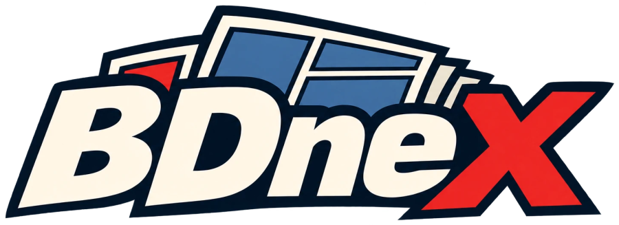

<p align="center">
  
</p>


[](https://codecov.io/gh/lbesnard/bdnex)
[](https://bdnex.readthedocs.io/en/latest/)

BDneX is a French comics tagger and library manager. **Documentation: <https://bdnex.readthedocs.io/en/latest/>**

> [!WARNING]
> **bdnex is under active development (pre-1.0).** The commands, the configuration file and the library
> database change often, **with breaking changes at any time and no deprecation period**. Some upgrades
> convert the database in place, after which an older bdnex refuses to open it.
>
> Until there is a 1.0 release: **back up your library database before upgrading** (bdnex also keeps `bdnex.sqlite.bak-v<N>` when an upgrade changes it) (`bdnex config --defaults`
> shows where it is), pin the version you install, and read the release notes. bdnex only changes your comic
> files when you ask it to (`write`, `move`, `repair`, or an import that places files); keep a backup of your
> collection as well.

> [!NOTE]
> **About this project.** I created bdnex around 2021 as a personal tool, but I did not have the time to keep
> developing it. I recently picked it up again and, working with [Claude](https://claude.com/claude-code)
> (an AI coding assistant), added the features of the roadmap (library database, matching, import, write/move,
> API and more). Much of the code is therefore AI-assisted; I review and test it, but it is young. Please keep
> backups of your comics and report any problem you find.

### Motivation
Contrary to music tagging, there is no agreed standard vocabulary for comics
tagging in general. However the ComicRack standard is used by most library
managers such as [Komga](https://komga.org/)

A few teams are working on metadata for American comics, such as [comic tagger](https://github.com/comictagger/comictagger)
This tool retrieves data from the ComicVine REST API [Comic Vine](https://comicvine.gamespot.com).
However it is mostly for american comics, and only the most famous french ones
are represented.

BDneX comes here to hopefully fill the gap, with search capabilities of metadata,
which then can be added to **CBZ** and **CBR** file format. 

Why doing this?
On big libraries, it becomes easy then to find a book, based on its genre,
community score, author, colorist, penciller!

Read List can then be generated and more easily shared accross the community as
based on metadata and not an obscure filename.

### Features
- `bdnex init` downloads the Bédéthèque album list (sitemaps) once, with a progress bar
- `bdnex import`: fuzzy-matches comic files (`.cbz`, `.cbr`, `.pdf`) against it (*match*), reads the
  album pages (*fetch*) and records everything in a SQLite library (series, one-shots, authors,
  genres, checksums). You confirm each match, or `--auto`; matching runs in the background on all cores
- duplicate handling, resume, remembered skips, `--match` / `--fetch` to run one step, `--force` to redo
- duplicates are shown side by side and you keep one, the other, or both: spare versions go to `_versions/`,
  replaced files to a restorable trash (`bdnex trash`)
- files imported from outside your library folder (a download folder) are moved or copied in, or left and placed later
- a **web page** (`bdnex serve`): browse the library as a wall of covers, see which volumes of a series are missing,
  review doubtful matches, and, if you allow it, run the same tasks as the command line without a terminal
- optional cover check (`pip install 'bdnex[cover]'`): the file's cover against the album's, with SIFT
- `bdnex edit`, `reparse`, `reset`, `relocate`: fix, rebuild offline, start over, move your collection
- `bdnex ls`: search the library (`series:nains author:uderzo year:2010..2015 ^genre:humour`)
- `bdnex write` / `bdnex move`: write `ComicInfo.xml`, convert CBR and PDF to CBZ losslessly
  (verified before anything is replaced), rename into a library tree from your own templates
- validated YAML configuration, with a message when it is stale

Inspired by the [beets](https://github.com/beetbox/beets) music manager.

## Album pages: read this first

Bédéthèque protects its album pages against scripted requests, and bdnex itself does not try to get around
that protection. This decides what works out of the box:

| | Needs the album pages? |
|---|---|
| `bdnex init`, matching files to albums, duplicates, `ls`, `edit` | **No**: it works offline from the album list (the sitemaps) |
| authors, publisher, ISBN, summary, genres, the cover link, and so the `ComicInfo.xml` tags | **Yes** |

Without a page an album is still linked from the list (series, volume, title) and shows as `[not fetched]`
in `bdnex ls`. Renaming and moving files works too, from what is known; a path template that uses a field
that comes from the page (`$authors` in the default one-shot template) asks for it or uses a placeholder
(`paths.missing_field`). To get the complete metadata **you supply the pages**, in one of two ways:

1. **Save them from your browser** (Ctrl+S, "Web page, HTML only") into `bedetheque.pages_dir`
   (`~/.local/share/bdnex/pages` by default), under any name that ends with the album id
   (`BD-Nains-Tome-1-Redwin-de-la-Forge-245127.html`, or just `245127.html`), then run `bdnex import --fetch`.
2. **Use a fetcher**: a function that takes a URL and returns the page as bytes. The default,
   `bdnex.importer.bedetheque:flaresolverr_fetch`, asks a FlareSolverr server whose address you give; or name your own:

   ```yaml
   bedetheque:
     fetcher_endpoint: "http://localhost:8191/v1"             # the default fetcher: your FlareSolverr
     # fetcher: "package.module:function"                     # or your own function: url -> page bytes
   ```

   bdnex checks when it reads the configuration that the function exists.

   How that function obtains a page is up to you, and so is respecting the site's terms of use.

Each page is stored in the library when it is read, so it is fetched once, and `bdnex reparse` can rebuild the
albums from the stored pages later without any network. See the documentation, *Getting started* and
*Configuration*.

## Installation

Requires Python 3.10 to 3.13. [uv](https://docs.astral.sh/uv/) is the recommended installer.

### Stable release (recommended)

```bash
curl -fsSL https://raw.githubusercontent.com/lbesnard/bdnex/main/install.sh | sh
```

The script fetches the latest GitHub release wheel and installs it with `uv tool`
(falling back to `pipx`, then `pip`).

Or with uv alone, always the **latest release** (no version to type):

```bash
uv tool install --force "$(curl -fsSL https://api.github.com/repos/lbesnard/bdnex/releases/latest \
  | grep -o 'https://[^"]*\.whl')"
```

The same line upgrades an installed bdnex to the newest release. A specific release, from the
[Releases page](https://github.com/lbesnard/bdnex/releases):

```bash
uv tool install --force https://github.com/lbesnard/bdnex/releases/download/vX.Y.Z/bdnex-X.Y.Z-py3-none-any.whl
```

### Latest from source (the `main` branch)

```bash
uv tool install git+https://github.com/lbesnard/bdnex.git
uv tool upgrade bdnex          # later: pulls the newest commit of the branch
```

With the optional cover check (OpenCV): `uv tool install "bdnex[cover] @ git+https://github.com/lbesnard/bdnex.git"`.

### Development

```bash
git clone https://github.com/lbesnard/bdnex.git
cd bdnex
uv sync --extra dev
uv run pytest
uv run bdnex --help
```

### Releasing

Run the **Release** workflow from the GitHub Actions tab and pick `patch`, `minor`
or `major`. It runs the tests, bumps the version in `pyproject.toml`, tags it, builds
the wheel and publishes a GitHub release.


## Documentation

The documentation is at <https://bdnex.readthedocs.io/en/latest/> (how to get started, a "How do I...?" page for the common tasks, the configuration and query references).

To build it locally: `uv sync --extra docs && uv run sphinx-build -b html docs docs/_build/html`, then open `docs/_build/html/index.html`.

## Examples

```bash
bdnex init                       # once: download the album list
bdnex import ~/comics            # match, read the album pages, record; you confirm each match
bdnex ls series:nains            # query
bdnex write                      # write ComicInfo.xml into matched files
bdnex move --copy                # copy into the library tree defined in the config
```

Full documentation: <https://bdnex.readthedocs.io/en/latest/>
