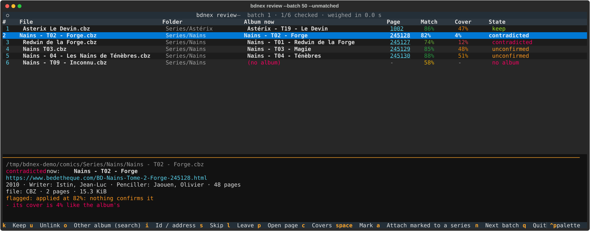
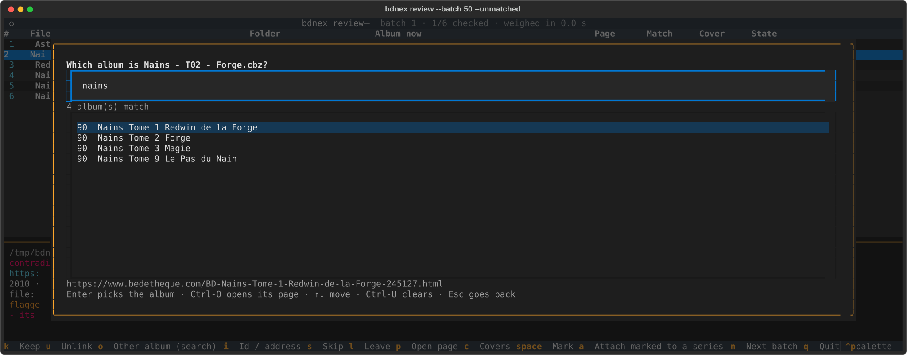
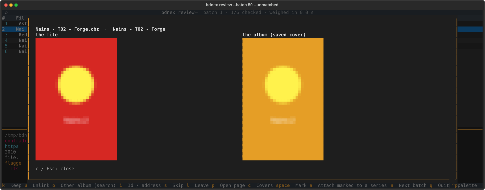

# Checking the matches, with or without an assistant

A big import by `--auto=all` is mostly right and sometimes wrong. These commands find the wrong ones, show what
else a file could be, and let you (or an AI assistant such as Claude Code, working for you) fix them. **Nothing here
changes a comic file, and nothing is unlinked or rematched without a decision.**

| Step | Command | What it does |
|---|---|---|
| 1. Find | `bdnex check --matches` | weighs every match against its album's page; lists the ones that look wrong, changes nothing |
| 2. Flag | `bdnex check --matches --fix` | the same, and flags them (`review:true`) |
| 3. List | `bdnex review --list` (`--json`) | the flagged files and why |
| 4. Alternatives | `bdnex candidates --low` (`--json`, `--cover`) | for each file in doubt, the other albums it could be, with the evidence |
| 5. Decide | `bdnex review`, `bdnex import --album ADDRESS FILE`, `bdnex edit` | keep, unlink, choose again, or fix a field |

What the checks compare (the file's own tags, the volume, the year, the authors, the other files of the folder) is
described in [Importing](importing.md). The page of an album has to be read for the year and
the credits to be known: run `bdnex import --fetch` (and `bdnex import --reparse` for pages already stored) first, otherwise most
files are `unverified`.

## Settling the doubtful ones at once: `bdnex review --auto`

`bdnex review --no-tui` asks about each flagged file (`bdnex review` alone opens the review screen, below). When there are thousands (an import flags every file whose cover does not
look like its album's, and a different edition or a PDF's first page often does not), `bdnex review --auto` weighs
**every flagged file and every match applied under `match.strong_threshold`** (an older `import --auto=all` applied the
ones in the middle unasked) and settles them by rule, asking nothing but one question before it changes anything.
It weighs each with what the library knows: the album's page, the file's own tags (year, author, address) and, with
OpenCV, the file's cover against the album's saved cover.

| Verdict | Means | What `review --auto` does |
|---|---|---|
| `kept` | something other than the name confirms it (the year, an author, the file's tags, a cover that looks alike by `match.cover_vote_min`) | the flag goes |
| `wrong` | something contradicts it (another volume, another series in its tags, a cover that looks little like the album's) | switches the file to a better album if the covers of its other candidates find one, else unlinks it |
| `unconfirmed` | nothing confirms it, nothing contradicts it | nothing: no evidence is no reason to ask you (a flag a medium match got is taken back) |

**The covers of the other candidates.** For each `wrong` file it compares the covers of its best other candidates
(`--candidates N`, 5 by default; `0` turns it off; `--no-cover` skips every cover) and says, for each file, the covers it
compared. A cover already saved is read from disk, any other is one request (a picture only; no page is read). When one
looks like the file's (`match.cover_vote_min`) and is clearly ahead of the album now linked and of the others (the rule
of the cover vote at the end of an import), the file is linked to it (the library only, as `import --album
--database-only` does). Otherwise it is unlinked and remembered as skipped, so `bdnex import --skipped` decides it again:
it comes back when it is strong, or when a cover clearly votes for one candidate.

A switch is counted only when the library shows it: if the better album already has another file (a duplicate), the import
refuses it, the file stays on its contradicted album, flagged with the reason, and the summary says so. The summary also says
why the unconfirmed ones could not be judged (most often: the album page was never read, so `bdnex import --fetch --select
partial:true` is the next step).

Files you chose (`import --album`, `review`) and the ones read from their own tags are never looked at. The usual order:

```bash
bdnex review --auto -n                # the numbers and what would change (the covers of the candidates are requested)
bdnex review --auto                   # settle them (asks once; -y to not ask)
bdnex import --skipped --auto=all     # then decide the unlinked ones again: strict, and the covers of the best candidates vote
bdnex review --no-tui                 # what is still flagged, one by one (no screen)
```

`-n` shows only the counts. `--json` prints the verdicts, with the evidence and the better album found, and changes
nothing. A digital edition whose cover differs from the print album's is contradicted by its cover alone: with no better
album it is unlinked, and `bdnex import --album` links it back. A shorter way to type it: an [alias](configuration.md#aliases-commands-with-a-name-that-says-what-they-do).

## The review screen: `bdnex review`

`bdnex review` in a terminal opens the review screen (`--no-tui` asks one file at a time instead; `--list` and `--auto` never open it). It works a batch at a time, with every decision saved as you make it. `--batch N` sets the size of a batch (50 by default):

```bash
bdnex review                          # the next 50 doubtful files, in a table
bdnex review --unmatched              # the same, with the files that have no album
bdnex review series:batman            # only some files (same terms as `bdnex ls --files`)
bdnex review series:batman --all      # every Batman file, the doubtful ones first, then the rest
bdnex review --again                  # the files you already checked too (the Review column says what you decided)
bdnex review --batch 100 --no-tree    # 100 to a batch, the left panel hidden
```

The last column, **Would go to**, is where `bdnex move` would put the file, relative to your collection: the `paths` template of the album's kind
(or the first rule that matches it) and the extension it would have (`Series/Nains/Nains - T01 - Redwin de la Forge.cbz`). It is worked out
offline for the album each file has now, so you can see whether a match would send a file to the right place; it is empty for a file with no
album, `?` when the template needs an answer only a question could give (a missing field), and a reason in brackets when it refuses the file (or
when no `collection_path` is set). It is worked out again the moment the row is linked or decided (the album, so the place, may change: a link written at once shows its new
place at once, before the page is fetched). The column is as wide as the screen allows (at least 44 characters), the detail panel shows the path in
full, and the number key `9` sorts by it.

By default the table holds **the doubtful files only**: a match something contradicts or nothing confirms, the same set
`bdnex review --auto` weighs (so there is no `--low`: it is what you get). `--unmatched` adds the files without album,
`--all` every file of the query (to look through a series), `--again` the ones already checked. They all go with `--batch`.



One row per file: its **name**, its **folder** (it often says the series or the language), the **album it is linked to now**,
the number of its **page** on the site (a link), the **match score** of the import, the **cover score** (the file's cover against the album's saved cover) and a **state**
(**Link**: `doubtful`, `medium match`, `auto matched`, `no album`, `manual` (you chose the album; no score): how the file was linked; **Review**: `confirmed · kept`, `confirmed · linked`, `confirmed · no album online`, `unlinked`, or `-`: what you decided). The batch is the most doubtful files (contradicted ones, lowest
cover first, then the unconfirmed, then, with `--unmatched`, the files without album), **shown folder by folder** so the files of one
series sit together (click a header to sort otherwise). Under the table: the file's whole path, the album's address, what the album
says (year, credits, pages) next to what the file is (format, pages, size), and what speaks for and against its match.

When you link a file to an album that **already has another file**, it is linked at once as a spare version (no question;
`bdnex duplicates` decides later which one stays). On the command line that is `bdnex import --album ADDRESS FILE --keep-both`.

| Key | Does |
|---|---|
| a click on a **column header**, or `1`–`8` | sort by that column (`1` is `#`, the order of the batch; `2` File, `3` Folder, `4` Album now, `5` Page, `6` Match, `7` Cover, `8` State); the same column again reverses it, and the title says `by cover ▼`. Rows without a value (no album, no score) stay last. The cursor stays on the same file |
| `k` | **confirm** the file: its match is right (the flag goes, the file is marked `checked=keep`, it turns **green**). Press it again to **unconfirm**. With files marked (`space`), all of them. On a file with no album it confirms *no album online* |
| `u` | **unlink** the file (remembered as skipped, so `bdnex import --skipped --auto=all` decides it again). An unlink is **not** a confirmation: the file stays red (no album) until you link it (`o`, `i`, `a`) or say `l` |
| `t` | **this file's candidates**: the few albums the matcher thinks it could be (the list `bdnex candidates` prints), best first, each with its score, year, publisher and what the evidence says, and below it where the highlighted score comes from. Quick, because it is not a search of the whole list: Enter links the highlighted one, Ctrl-O opens its page, `o` goes on to the big search, Esc goes back. Use it when two editions of a book score alike |
| `o` | **another album**: a search box in the screen over the whole album list (the sitemaps), starting from the file's name. It filters as you type like `fzf`: words in any order, accents ignored, and a fuzzy match when a letter is missing. Enter picks, Ctrl-O opens the page, Ctrl-U clears, Esc goes back |
| `O` | the real `fzf`, when it is installed (the screen steps aside for it and comes back) |
| `i` | an album's page address or number |
| `s` | skip for now (nothing is saved: it is in the next batch again) |
| `l` | **no album online**: you looked, nothing exists on the site for this file, so it stays without an album and is **confirmed** (green). For a file that has an album, `k` confirms it; `u` unlinks it first |
| `d` | **the metadata of the album** the file has now, in a panel on the right of the detail (**shown by default**; `d` hides it and the screen remembers): series, volume, date, publisher, language, pages, ISBN, credits, genres, the summary, where it comes from, and (in yellow) what you changed by hand. It follows the row under the cursor. | The panel is a view: nothing is changed by looking. |
| `e` on a file with an **album of the site** | **change that album's metadata**: the same form as below, **series name included**: changing it renames the series for **all** its albums, so the screen asks first and says how many (`Rename the series 'A' to 'B'? It changes all 12 albums...`); answering no keeps the name and saves the other fields. The rows of the batch that belong to the series follow. What you change is saved as your own edits (the same ones `bdnex edit` makes): a later import or `--fetch --force` does not undo them, and `bdnex write` puts them into the file. The table, the panel and *Would go to* follow at once. | Escape closes the form unchanged. |
| `e` | **write the metadata by hand**, for a comic the site does not know. On one file: a form (series, volume, special, title, subfolder, collection, cycle, publisher, ISBN, year, month, day, language, format, pages, writers, artists, inkers, colorists, letterers, cover artists, genres, summary; the series and the volume are guessed from the folder and the file name), the **OK** button (or `Ctrl-S`, which some terminal multiplexers take) saves it as an album of your own (`source: manual`) and links the file to it; **Cancel**, `Esc`, or `x` when the cursor is not in a text field, closes it without saving; `e` again on that file edits it. With several files marked (`space`, `m`): one form for the series (name, collection, publisher, year, language, format, the credit roles, genres, summary) and a line per file with the volume read from its name, which you can change: one album per file, all of that series. A file that has an album of the site is not edited here (`u` unlinks it first, or `bdnex edit` changes the fields) | **With several files marked, `e` opens the same form as `E`**: it shows what they share, or `(several values)` where they differ, and never one file's name for all of them.
| `?` | every key, on one screen. A line of **tips** at the bottom shows one at a time (double-click a header, drag the bars to resize, ctrl-click...); `Ctrl+P` *Tips line* hides it |
| `C` | **the columns** of the table: tick the fields to show (title, series, collection, authors, genres, format, size, reviewed...); **double-click a header** to change just that column's field (or hide it). A single click on a header still sorts. The columns, the size of the panes and the tab of the left panel are saved in the library, so the screen opens as you left it |
| a mouse drag on the thin bars between the panes | resize the left panel, the filters, the detail pane |
| ctrl-click a row | mark it, like `space` |
| `f` | **the left panel** on or off: the folders, the organised folders, and the filters (`--no-tree` starts with it off; the screen remembers how you left it, in the library). Enter or a click on any entry shows **all its files, everything below it** |
| `R` | the folder on the screen is **reviewed**: every file of it not yet reviewed is marked (a flagged match is kept; nothing is moved, unlinked or written). It asks first and says how many |
| `D` | **the duplicates** of the file under the cursor (the other files of its album), side by side: format, pages, size, damaged or not, and which one `move` would keep and why. `↑↓` pick a file, then `t` **trash** it (a true duplicate: `bdnex trash --restore` brings it back), `m` make it the **main** file (the others become spare versions), `v` it is a **different version** (black and white, an older edition): it gets an album of its own (a hand-written one with its own number, the same series and volume, your note after the title) linked to the first as its *version*, `c` the same as a *child*, `r` it is linked to the **wrong album** (opens the search `o`), `b` or Esc leaves both as they are. A *version* is always placed in the spare versions folder |
| `E` | **one form for the marked files** (`space`, `m`; without a mark: the file under the cursor): every field of the album, the **kind** (series, with the name typed above; or one-shots), and a volume for each file (buttons number them 1..n or read the file names). The grey text of a field is what all the files already have in common (`(several values)`, in orange, when they do not); what you type is set on all of them, the **Empty** button next to a field clears it on all of them (typing `-` does the same), a field left alone is not touched. Everything is checked first: one bad value writes nothing. The files are marked reviewed. A file with no album gets a hand-written one |
| `K` | **series or one-shot**: the marked files (or the one under the cursor) that are in a series become one-shots; one-shots become a series (asked for its name, the folder's by default). Kept when the album is read again |
| `V` | the **volume** of the file under the cursor: type it, Enter saves it and moves to the next file |
| `m`, `x`, `v` | `m` marks every file not decided yet and again none (`x` unmarks everything; `m` was dropped: terminal multiplexers use it themselves); `v` shows or hides the **log** at the bottom of the screen: what bdnex is doing (pages read or fetched and how long, links), as `-vv` shows (`-vv` adds the debug lines). Nothing is printed under the screen. `y` copies the whole log to the clipboard; the panel follows new lines only while it is scrolled to its end, so scroll up to read in peace |
| `w` | **the questions that wait**. A question that comes by itself (the answer to `a`: link the files to the series, or write them by hand; a finished batch: check the next one?) never opens over what you are doing: it waits in a queue, a **red mark at the top right** says how many (`● 2 questions waiting · w`) and a note tells you the first time. Press `w` when you have a hand free and the oldest one opens; the next one comes with the next `w`. While a window is open (a search, the hand-written form) `w` says to finish it first. | Nothing is asked of you until you press it. |
| `space`, then `a` | **several files of one series at once** (with one file and no mark, `a` links the album you pick, exactly; pick a **SERIES** to give the file its volume by the number in its name): `space` marks the file under the cursor (`m` marks all the files not decided yet, and again none), `a` asks for any album of the series (the same search as `o`, which also lists the series of the series index read by `bdnex init`, marked `SERIES`, in a column of its own next to `album`: picking one is giving its address) and gives each marked file the album of that series with the volume number in its name (`T03`, `Tome 3`). Instead of an album you can type the address of the series page (`bedetheque.com/serie-18658-BD-Boys.html`, which the album list does not contain): bdnex reads that page (from its library, or from the site once) and takes the albums it lists. `i` accepts the same address. Without a mark, `a` is for **the file under the cursor only** (the heading names it; one-shots such as `Batman - Killing Joke` share a folder but are not one series), and it works on a file already decided too, so a wrong `keep` can be matched again; press `m` first to mark every file not decided yet when a whole folder is one series. When you give a series page and **none** of the marked files finds its volume on it (the page lists volumes 1 to 4, your files are numbered 5 to 25: another series, or one the site does not have), the screen says so in words and asks whether to **write those files by hand as that series**: yes opens the same form as `m` then `e`, with the series name and each volume read from its file name. It shows what it will do and asks before linking one by one | The search screen shows the folder and name of the file(s) it is for, and has two tick boxes, **SERIES** (`F2`) and **Albums** (`F3`): each kind is searched on its own, so a name with many series cannot push every album out of the list, and you can look at only one of them.
| `c` | a popup with the **file's cover** next to the album's **saved cover**, drawn with coloured text (works over SSH, no picture protocol needed). Nothing is fetched: when the album's cover was never saved it says so (`bdnex import --fetch` saves it). `c` or Esc closes it. **`z` shows one picture full size** (to read the credits): `←` `→` turn the pages of the file, `Tab` shows the album's saved cover, **`+` / `-` zoom** (2x to 12x: small writing is only readable zoomed, a terminal has few cells) and `↑ ↓ h l` move over the page. It is drawn with `chafa` when it is installed (`apt install chafa`, `brew install chafa`: much sharper than the default half blocks), so it works over SSH and in tmux. **`cover.picture`** in the configuration chooses how: `chafa` (the default: text, any terminal), `blocks` (text, nothing to install), or a real picture, `kitty` (the sharpest, when your terminal shows it: kitty, Ghostty, WezTerm), `iterm2` or `sixel`. A real picture needs chafa too, a terminal that can show it, and, in tmux, `set -g allow-passthrough on`; a tmux inside a tmux (or over ssh into one) usually blocks it. It is written straight to the terminal and was not checked on a real one: if it shows nothing, go back to `chafa`. |
| `p` | open the page of the album now linked, in your browser. Over SSH (where a browser would open on the other machine) the address is copied to your clipboard (where the terminal allows it) and shown; the **Page** column and the address under the table are links too: ctrl/cmd-click them in a terminal that knows links |
| `n` | the next batch (it is weighed in the background while you work on this one, so it appears at once; after `b`, the batch you left) |
| `b` | the previous batch, with the decisions you made in it (and the fetches still running for its files) |
| `/` | **search the table**: a text box to jump the cursor to a row whose file name, folder, album, *Would go to* path or state holds the words you type, whatever the column (`n`/`b` already mean the next/previous batch, so this is not vim's `/` + `n`) |
| `]`, `[` | the next, or previous, row that still matches the last `/` search, wrapping around; nothing moves (and it says so) when there is no search yet, or nothing else matches |
| `q` | quit |

### The left panel

Three views of the same library, all one click from the table on the right. Counts follow your decisions a moment after you make them, and the second tree follows your edits.

- **Folders**: the folders as they are on disk. Every **file** has one of four colours, and a folder takes the colour of its worst file that you have not confirmed (green when all are confirmed); a parent counts everything below it. The shape says it too, so colour is never the only sign:

  | | colour | meaning |
  |---|---|---|
  | `●` | **green** | **confirmed**: you decided (kept the match, linked it, or said there is no album online) |
  | `○` | **cyan** | **auto matched** (a strong match: the import's score is at least `match.strong_threshold`, nothing against it) or **manual** (you chose the album: written by hand, or given by its address or number with `--album`, so the import recorded no score), not confirmed yet |
  | `◐` | **orange** | **medium match**: applied with a lower score, not confirmed yet |
  | `✖` | **red** | **doubtful** (flagged: something is against the match) or **no album**, not confirmed: look here first (`!3`: how many) |

  The number is `confirmed/total`. A file you **confirmed** is green whatever else is true of it, so a file with no album online turns green once you press `l`. An unlink does not confirm. Each entry has a box: **space, ctrl-click ticks it, shift-click ticks everything from the last one ticked to this one**; `Show ticked` (or `T`) shows the files of everything ticked, `Clear ticks` unticks all. Folders are alternatives; so are the values of one filter; different kinds go together (these folders **and** this genre **and** not confirmed). A letter shows, or ticks, all the folders under it. In the table, shift-click (or shift with the arrows) marks a list of rows. *Shift-click is often taken by the terminal for selecting text: then use shift with the arrows, or ctrl-click.*
- **Organised**: the folders `bdnex move` would build from your `paths` templates, with the same colours: the tree you will have, so a series filed under three names or a missing `$category` shows before any file moves. It is worked out in the background a couple of seconds after the screen opens (about 0.1 ms per file) and follows an edit: change a series, a collection or a category and the files of that album move in the tree.
- **Filters**: a tree of questions with the number of files for each answer. **Colour** (green, cyan, orange, red: the same four colours), **Link** (auto matched, medium match, doubtful, no album, manual), **Review** (confirmed, not confirmed, **no album online**: confirmed with no album, nothing exists online for it), **Other** (several files for one album, a version or child of another album, damaged). Then *Kind* (series or one-shot), *Category*, *Collection*, *Genre*, *Author*, *Series*, *Publisher*, *Format*, *Language*. A long list (authors, series) is grouped by first letter. Album titles are not a filter: that is what `/` and `o` are for.

The table shows a selection **one page at a time** (50 files, or the `--batch` size), in path order, and the title says `1-50 of 1847 · page 1/37`: **`n` and `b` turn the pages** (so do the arrows `◀` `▶` under the table, with the click) (past the last page, `n` goes on to the next batch). A click on a header sorts the page on the screen. Opening any page takes about a tenth of a second, because it is one indexed query (schema v17 adds the indexes), not a weighing of every file. The columns *Kind* (series or one-shot) and *Vol* are at the right of the table.

`Ctrl+P` opens the **command palette**: every action of the screen by name (duplicates, the form for the marked files, series or one-shot, the volume, the covers...), and every filter value: type `series klez`, `genre fantasy`, `author herg`, `state dupl` and Enter.

**Another album (`o`)** is a search box over the whole album list, and **`c`** shows both covers:





(The pictures come from a demo library of made-up files: `uv run python tools/review_screens.py docs/_static/screens` draws them again.)

The screen **opens at once**. While the batch is made it shows a loading panel with the two jobs and how long each has taken:
`weighing the files` (the table appears when that is done; the title then says `weighed in 6.2 s`) and `loading the album list`
(the search waits for that one, in the background), so you always see what it is doing. Picking an album **links the file at once**: the link is written in the library before anything is fetched, the row says `linked`
(`you` as the match) and you can go on, to the next row or the next batch. The album's page and cover are then fetched in the
background (the log panel says what it is doing). With several fetcher endpoints (`fetch.endpoint`, or `fetch.parallel`) the pages and covers of **several files are downloaded at once, as many as `bdnex import` would fetch**, each request still waiting its polite delay, and every file being fetched shows a turning wheel; the library is still written one file at a time, so two files of one series never clash. With one endpoint it is one file at a time. The row's state says `linked · fetching` until they are
there, then shows the cover score. A mistake is one `u` away: **unlink** removes the link from the library and cancels what was
queued for that file (a fetch already running cannot be stopped, but its result is dropped). If you quit with some pages or
covers still to come, bdnex says how many: `bdnex import --fetch` gets them.

Each decision is **written at once** to the library (a `checked` mark, the flag, the link), so quitting, Ctrl-C or a lost SSH
connection loses nothing. Files already checked are not shown again: **run the same command later to continue**. At the end
of a batch it asks whether to check the next one. Textual is installed with bdnex; if it is missing,
`bdnex review --no-tui` and `bdnex review --auto` work without it. Linking to another album
reads that album's page (a request), so it takes a moment; a file whose chosen album already has another file is refused
and says so.

## By hand

```bash
bdnex check --matches               # how many look wrong, and why (changes nothing)
bdnex check --matches --fix         # flag them for `bdnex review`
bdnex candidates --low --limit 5    # the other albums they could be
bdnex review --no-tui               # one by one, with the two covers side by side
```

`bdnex candidates` always needs to be told which files: a query (`bdnex candidates series:nains`), `--low` (the files in
doubt), or `--all` for every file of the library. With `--cover` each file can cost up to `--limit` cover requests, so the first
line says how many it could be. Each file is printed as `[n/total]` as soon as it is done, so Ctrl-C loses nothing.

## With an assistant (Claude Code)

The repository ships a skill, `skills/using-bdnex` (see [Getting started](getting-started.md)), that teaches the
assistant the safety rules and these commands. Copy it to `~/.claude/skills/`, open Claude Code in your project and ask,
for instance:

> Check the matches of my library. Run `bdnex check --matches`, then `bdnex candidates --low --json`, and for each
> file say which album it is, how sure you are and why. Don't change anything until I say so.

What the assistant does with it:

1. reads the evidence (`--json` gives the file, the album now linked, every candidate with its score, the signs for
   and against, and with `--cover` the cover similarity);
2. proposes, per file, **keep**, **another album** (its address) or **leave**, with a confidence (high when several
   independent signs agree, such as the year, an author and the cover; low when only the name matches);
3. after you approve, runs the command that does it: `bdnex import --album ADDRESS FILE` (the album it found, nothing asked),
   `bdnex review` (keep or unlink) or `bdnex edit` (a wrong field). It never edits the database file.

`--cover` compares the file's cover with each candidate's: it reads the cover the import already saved (`cover.download`) and makes one request for any other candidate (so keep `--limit` small),
needs OpenCV, and, for an album whose page was not read, looks at the address the site uses for covers, which can be
wrong (that candidate is then not compared). A cover that is *very* like the file's settles most questions of a reissue
against an original; a low similarity alone proves nothing (scans are cropped and compressed).

To remember what was looked at, so that a long check can stop and resume, the assistant marks each file it dealt with
(`bdnex mark FILE-QUERY --set checked=keep`, or `checked=other:245127`), and asks only for the others:
`bdnex candidates --low ^attr:checked --json`. You can list what it decided with `bdnex ls --files attr:checked=keep`.
The mark says what was decided, not that it was applied: only `bdnex import --album` changes a match.

An assistant is a reader of the evidence, not an authority: it can be wrong, it cannot see your files, and it does not know
which edition you want. Keep it to **proposals**, check the ones it is not sure about with `bdnex review`, and
back up the library first ([Safe workflows](safe-workflows.md)). Nothing leaves your machine except what the assistant
itself sends to its provider (file names and album titles are part of that: do not use it if that is a concern).

The box **Apply filters to folders** above the left tabs makes the two work together: with it ticked, a click on a folder keeps the filters on the screen (and a click on a filter keeps the folder), so `Colour: red` and a folder give the red files of that folder. The list of `a` (pick an album or a series) shows the year and the author of the albums the library already has.
