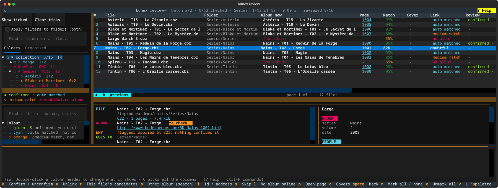

# The workflow: import, then review

Two tools do most of the work. **`bdnex import`** links your files to Bédéthèque albums, in bulk. **`bdnex review`** is the screen where you
look at the result, fix what is wrong and organise the collection. Everything else (`write`, `move`, `check`...) is a step you run when you
are happy with what you see.



## 1. Set up, once

```bash
bdnex config --edit        # set `collection_path` to your comics folder
bdnex init                 # download the album list (about a minute, 70 MB)
```

`bdnex init` is the one thing every other step needs: file names are matched against that list, offline. (`bdnex import` offers to run it
if you forgot, but it is easier to follow when you do it first.)

## 2. Import: link everything, ask nothing

For a collection that already has some order (folders by series, names with a volume number):

```bash
bdnex import -n ~/comics                        # preview: what would be matched, nothing changes
bdnex import --match --auto=all ~/comics        # link the files that match well; never asks; no page is requested
```

`--match` links each file to an album using only the album list, so it takes seconds, not days. `--auto=all` applies only the **strong**
matches that nothing contradicts; every other file is left for the review. Nothing is moved or written yet: your files are not changed.
It is safe to run again, and to stop with Ctrl-C.

## 3. Review: look, fix, confirm

```bash
bdnex review               # the first time
bdnex review --continue    # every time after: back where you were
```

`--continue` opens the screen as you left it: the folder or filters you were looking at (and the page), the sort, what you typed in the
find boxes, the ticks, and the query you started with. The columns and the size of the panes are always kept.

The screen opens on the files that need a look first (doubtful matches, then files with no album). The left panel is the whole
collection: **folders** (red where something is doubtful, green when you confirmed everything), the **organised** tree (where
`bdnex move` would put the files) and **filters** (author, series, genre, link, review...).

What you do there:

- **Confirm** a match (`k`: the file turns green), **unlink** a wrong one (`u`), or pick the right album (`o`, a search in the whole album list).
- **Edit** the metadata of one file, or of many at once (`e`, `E`): series, volume, collection, cycle, category, and *Version of the album*
  (dossier, cahier, black and white...). Restore puts a field back to what Bédéthèque says.
- **Duplicates** (`D`): the files of one album side by side; trash one, make one the main file, keep one as a version.
- **Find** a folder or file (`F`) or a filter value (`S`) as you type. Press `?` for every key.

Every decision is saved at once. You can close the screen at any time; it remembers its columns and panes, and the album pages and covers
it needs are downloaded in the background while you work. See [Checking matches](checking-matches.md) for every key.

## 4. Write and move, when you are happy

In the review screen, **W** (write) and **M** (move) act on the files of the view you are looking at: a folder, a filter, what you ticked (every
page of it), and **H** (repair) rebuilds the damaged ones. The **Write**, **Move** and **Repair** chips under the table do the same. A window says
what would change, and **Do it** does it. At the top of the window a choice says **this view** or **the whole collection**. To find the damaged
files first, use the **damaged** filter (group *Other*). The same from the command line, for the whole library or a query:

```bash
bdnex write -n        # preview the tags that would be written into the files
bdnex write           # write ComicInfo.xml into the files, where they are
bdnex move -n         # preview the new places
bdnex move            # write the tags AND rename the files into the tree of your `paths` templates
```

`write` puts the metadata in the files and leaves them where they are. `move` does that too and then renames and moves them into
the tree (so `bdnex move` alone is enough when you want both). Both take a query, so you can do a series, or what you just confirmed:
`bdnex move series:tintin`.

## 5. Later: new albums from a folder

Once the library is in order, new files arrive in a download folder or a NAS inbox. List that folder once as an import **source**
(`bdnex config --edit`):

```yaml
import:
  sources:
    - {path: ~/Downloads/comics, mode: move}          # emptied as the files are placed
    - {path: /mnt/nas/inbox, mode: copy, name: nas}   # read-only: the originals are never touched
```

Then, each time something new arrives:

```bash
bdnex import --sources --auto=all     # match the new files, tag them, put them in the collection; never asks
bdnex review --continue               # in the screen: Filters, Added, "last day" (or "last 7 days") shows exactly what just came in
```

`--auto=all` applies the strong matches and leaves the others for the review, as in step 2. Files already imported are skipped, so it is safe to
run as often as you like (`bdnex serve` can also watch the folder for you: see [Importing](importing.md#watching-the-sources-watchenabled)).
In the **Added** filter, confirm what is right (`k`), fix what is not (`o`, `e`), and the folder tree shows where the new files went.
`mode: copy` keeps the originals: they are never changed or removed.

## And after

- Two versions of a book, a replaced file, a wrong match found later: [Versions](versions.md), [Checking matches](checking-matches.md).
- Which tool does what: every entry of [How do I…?](cookbook.md) is tagged **CLI** (a command), **TUI** (the review screen) or both.
